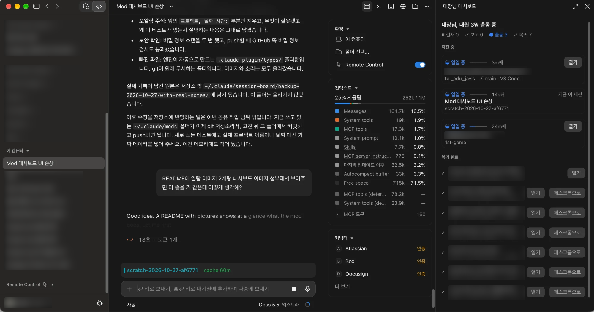
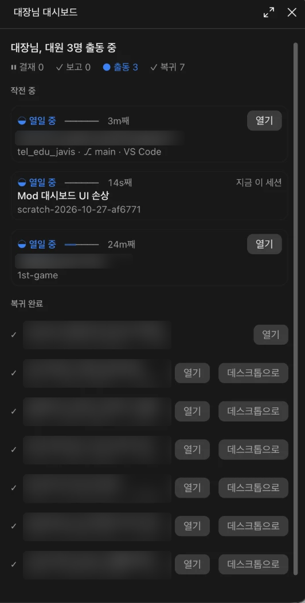
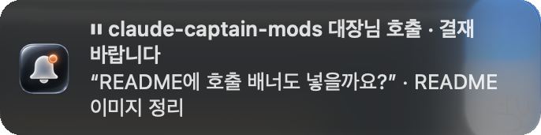
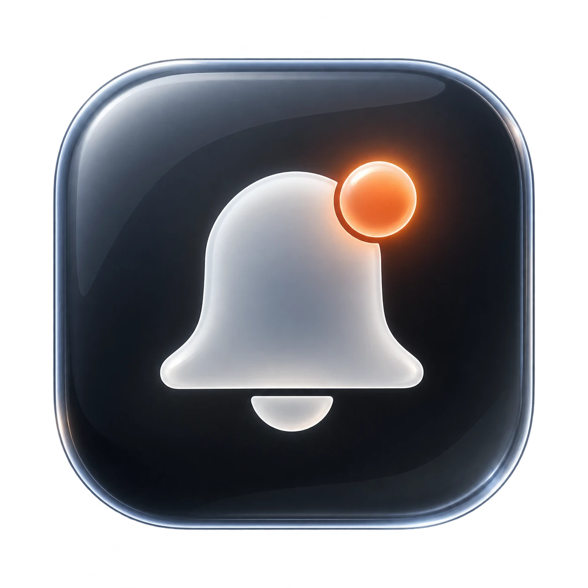

# claude-captain-mods

Claude Code 데스크톱 앱에서 쓰는 모드 두 개입니다. 여러 세션을 동시에 돌릴 때 "누가 결재를 기다리는지, 누가 일을 끝냈는지"를 한눈에 보게 해 줍니다.



<sub>오른쪽 패널이 session-board, 입력창 바로 위 띠가 devline입니다. VS Code에서 돌고 있는 세션(`tel_edu_javis · VS Code`)도 데스크톱 앱 한 곳에서 지켜봅니다. 다른 세션의 제목은 흐리게 가렸습니다.</sub>

## session-board — 대장님 보드

`/board`로 여는 옆 패널입니다. 이 컴퓨터에서 최근에 쓴 Claude Code 세션(데스크톱 · VS Code · 터미널)을 대화 기록에서 읽어 상태별로 보여 줍니다.

<p align="center">
  
</p>

- **결재 대기**: 허가나 답을 기다리는 세션. 얼마나 기다렸는지 게이지와 함께 표시
- **완료 보고**: 방금 끝난 세션. `열기`나 `확인`을 누를 때까지 카드가 남음
- **작전 중**: 지금 일하는 세션, 백그라운드 작업을 기다리는 세션
- **복귀 완료**: 끝난 지 좀 된 세션

세션이 끝나거나 사람을 부르면 macOS 알림 배너가 뜨고, 배너를 누르면 그 세션으로 갑니다. 5초마다 다시 읽습니다.

| 호출 | 완료 |
| :-: | :-: |
|  |  |
|  |  |
| 결재나 답을 기다릴 때 | 일을 끝냈을 때 |

## devline — 프롬프트 위 상태 띠

<p align="center">
  
</p>

- 프로젝트 · 브랜치 · 커밋 안 한 변경 수
- 프롬프트 캐시가 얼마나 남았는지(`cache 50m`), 캐시를 거의 못 쓴 요청은 `cache miss`
- 다른 세션이 결재를 기다리거나 방금 끝났으면 띠에 표시(session-board가 필요)
- 도구 호출 줄을 `SH` · `READ` · `EDIT` 같은 색 배지로 표시

`/devline band`, `/devline rows`로 띠와 배지를 각각 켜고 끕니다.

## 설치

session-board를 먼저, 그다음 devline을 설치합니다.

터미널 세션의 프롬프트에서:

```
/plugin install session-board --marketplace SeoJHeasdw/claude-captain-mods
/plugin install devline --marketplace SeoJHeasdw/claude-captain-mods
```

마켓플레이스를 추가할지 물으면 `y`, 범위(scope)는 Enter로 user를 고릅니다.

셸에서:

```bash
claude plugin install session-board --marketplace SeoJHeasdw/claude-captain-mods
claude plugin install devline --marketplace SeoJHeasdw/claude-captain-mods
```

데스크톱 앱에서는 `/plugin`이 동작하지 않습니다. 프롬프트 옆 **+** → **Plugins** → **Add marketplace**에 `SeoJHeasdw/claude-captain-mods`를 넣고, **Add plugin**으로 두 모드를 추가합니다.

## 알림 배너 앱 만들기 (선택)

이 단계를 건너뛰어도 알림은 뜨지만, 아이콘과 소리가 없는 기본 배너로 뜹니다. 전용 아이콘과 효과음이 있는 배너를 쓰려면 설치 후 한 번 실행합니다.

```bash
zsh ~/.claude/plugins/cache/claude-captain-mods/session-board/*/notifier/build.sh
```

- 필요한 것: macOS 13 이상, Apple Silicon Mac, Xcode Command Line Tools(`xcode-select --install`)
- `~/.claude/session-board/notifier/`에 `Done.app`(완료)과 `Call.app`(호출)을 만들고, 효과음을 `~/Library/Sounds`에 복사합니다.
- 처음 배너가 뜰 때 macOS가 알림 허용 여부를 묻습니다.

아이콘은 `notifier/icons/`의 PNG(1024×1024), 소리는 `notifier/sounds/`의 WAV를 바꾸고 `build.sh`를 다시 실행하면 됩니다. 효과음은 `sounds/make_sounds.py`로 직접 합성한 것이라, 음이나 길이를 고쳐서 다시 만들 수도 있습니다.

## 참고

- Claude Code 2.1.308에서 확인했습니다.
- 두 모드 모두 Claude Code 데스크톱 앱 세션을 위한 것입니다. 다른 클라이언트가 띄운 세션에서는 아무것도 그리지 않습니다.
